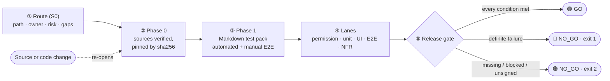
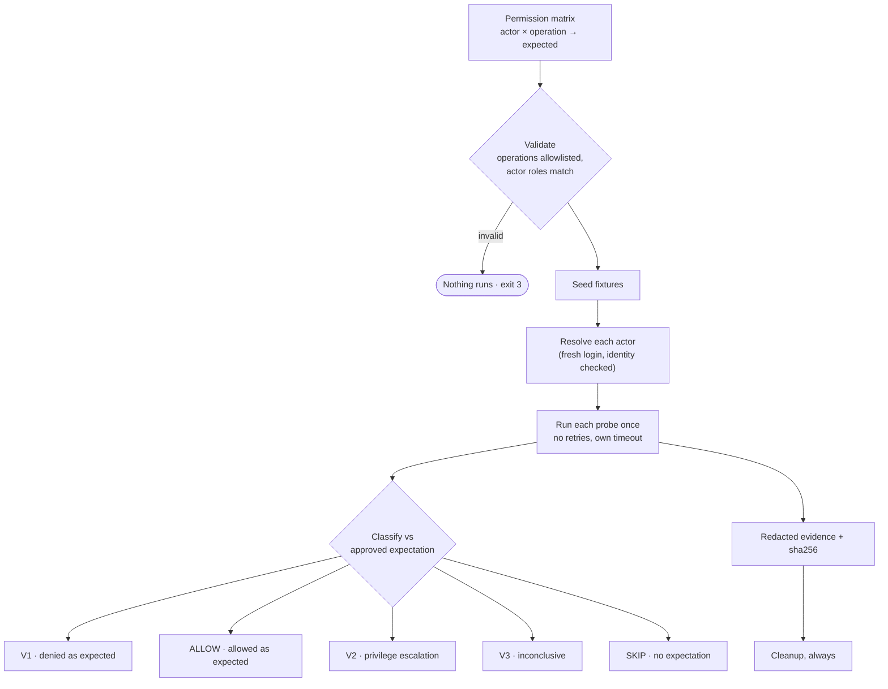

<div align="center">

# 🛡️ QA Agent Kit

**Evidence-driven QA for pull requests: deterministic permission testing, an evidence registry and a release gate that says GO or NO_GO.**

[](https://github.com/dab246/qa-agent-kit/actions/workflows/ci.yml)
[](.nvmrc)
[](tsconfig.json)
[](package.json)
[](https://github.com/dab246/qa-agent-kit/commits/main)

[Quick start](#-quick-start) · [How it works](#-how-it-works) · [Integrate it](docs/integration.md) · [Commands](#-commands) · [Security](SECURITY.md) · [Docs](#-documentation)

</div>

> [!IMPORTANT]
> **AI may propose a conclusion; PASS/FAIL and release eligibility come only from validated test results and policy.**
> The deterministic engine executes and classifies; AI can draft tests and triage failures, but can never change an approved expectation, a result or the gate.

## ✨ Highlights

| | |
| --- | --- |
| 🔐 **Permission engine** | Actor × operation × expected outcome matrices, run against your REST/GraphQL API. Catches privilege escalation (**V2**) and data leaking through a denial. |
| 🧾 **Evidence registry** | One redacted, checksummed evidence file per test; tampering is detected when the gate is re-evaluated. |
| 🚦 **Release gate** | A pure policy function: GO only when every required test passed, evidence is complete and the humans signed off. |
| 🔁 **QA lifecycle** | Route (S0), Phase 0 sources pinned by sha256, Phase 1 Markdown test packs, manual E2E sign-off, change-impact loop. |
| 🧩 **Any test tool** | Vitest, Jest, Playwright, Cypress, k6, pytest… anything that writes JUnit XML becomes a lane the gate judges. |
| 🤖 **Advisory AI** | Test proposals and failure triage with versioned prompts, validated before anyone sees them. |

## 🚀 Quick start

```bash
npm ci --ignore-scripts
npm run check          # typecheck + tests + build
npm run demo           # example app, correct      → 🟢 GO     (exit 0)
npm run demo:bug       # example app, injected bug → 🔴 NO_GO  (exit 1, V2 privilege escalation)
```

Each run writes `artifacts/demo/<run-id>/` with `report.md`, `summary.md`, `gate.json`, `run.json`, `junit.xml` and `evidence/`.

> [!TIP]
> Start your own suite with `npx qa-agent-kit init qa`, then follow the [integration guide](docs/integration.md). A real, browser-only example lives in [ChronoWork's `qa/` folder](https://github.com/dab246/ChronoWork).

<details>
<summary><b>What the demo report looks like</b></summary>

```text
# QA release gate: 🔴 NO_GO (RED)

| 🔴 | CRITICAL_VIOLATION | permission:settings-permissions:regular-user-update-admin-settings | PRIVILEGE_ESCALATION: expected HTTP 403, got 200 |
| 🔴 | LINKED_TEST_FAILED | ... | TC-SET-002 → permission:settings-permissions:regular-user-update-admin-settings failed |

## Actor matrix
| Operation             | administrator | anonymous | other-user (regular-user) | regular-user |
| project.read          | ·             | ·         | V1 pass                   | ALLOW        |
| settings.admin.update | ALLOW         | ·         | ·                         | V2 violation |
| settings.read-own     | ·             | V1 pass   | ·                         | ALLOW        |
```

</details>

## 🧭 How it works

### QA lifecycle



The **main gate** of the lifecycle: automated results count only when the intake was accepted, the cost/value decision is GO and the required manual E2E cases passed.

### Permission engine



| Diagram label | Status | Category | Gate |
| --- | --- | --- | --- |
| **V1** denied as expected | `PASS` | — | counts as passed |
| **ALLOW** allowed as expected | `PASS` | — | counts as passed |
| **V2** violation | `FAIL` | `PRIVILEGE_ESCALATION` | 🔴 always blocks, cannot be waived |
| 403 that leaks data | `FAIL` | `DATA_DISCLOSURE` | 🔴 always blocks, cannot be waived |
| **V3** inconclusive | `INCONCLUSIVE` | `UNRESOLVED_REFERENCE`, `BODY_INCOMPLETE` | 🟠 blocks when required |
| **SKIP** no expectation | `INCONCLUSIVE` | `NO_EXPECTATION` | 🟠 never a PASS |

## 🧰 Commands

| Command | Purpose |
| --- | --- |
| `init <dir>` | Scaffold a suite from `examples/minimal-permission-suite` |
| `validate` | Validate config, matrices, test packs and target declarations (no network, no secrets) |
| `run` | Full pipeline; `--ci github` binds to the PR head, `--summary` writes the job summary |
| `gate --run <dir>` | Re-evaluate a recorded run after manual E2E, intake or approval changes |
| `impact` | Show which matrices a change selects |
| `sources check \| rehash` | Phase 0 check; re-pin changed files and drop approval to PENDING |
| `proposal review --proposal <file>` | Review an AI test proposal (never edits a matrix) |
| `triage --run <dir> [--import <file>]` | Group failures; validate an AI triage |

<details>
<summary><b>Exit codes</b></summary>

| Code | Meaning |
| --- | --- |
| `0` | 🟢 GO |
| `1` | 🔴 NO_GO: definite failure (violation, failed required test, failed manual E2E) |
| `2` | 🟠 NO_GO: needs review (blocked, inconclusive, missing evidence or sign-off) |
| `3` | Invalid input; nothing was executed |
| `4` | Internal error |

CI must treat every non-zero code as a failed check.

</details>

<details>
<summary><b>How the kit maps to the two source diagrams</b></summary>

| Diagram step | Kit |
| --- | --- |
| 1. Initialization and routing (S0, Path A/B/C/D) | `qa-route.yaml` + `routing.paths` |
| 2. Phase 0: source validation | `source-manifest.yaml`, sha256-pinned sources, `sources check / rehash` |
| 3. Phase 1: test packs, manual E2E | Markdown test packs (source of truth), `manual-results.yaml` |
| 4. Execution lanes (API/UI/NFR) | permission lane (built in) + any lane through JUnit XML intake |
| 5. Release gate | deterministic policy evaluator, exit codes for CI |
| Change loop | `impact.rules` (unknown impact ⇒ run everything), Phase 0 re-opened on source change |
| Permission engine boxes 1–7 | seeding, matrices, actors, operation allowlist, shared driver, evidence + report |

</details>

## 🔌 Integrate it into a project

| The project has… | Use |
| --- | --- |
| An HTTP/GraphQL API with logins and roles | Permission lane (`target.yaml` + matrices) **and** everything below |
| Tests in any tool that writes JUnit XML | Lane intake (`lanes.<name>.junit`) |
| Requirements, ADRs, policies | Phase 0 sources |
| Manual or exploratory checks | Markdown test pack + `manual-results.yaml` |

```yaml
# .github/workflows/qa-gate.yml (excerpt)
- run: bunx vitest run --reporter=default --reporter=junit --outputFile.junit=qa/reports/unit-junit.xml
  continue-on-error: true      # the gate judges the results
- run: node .qa-agent-kit/dist/cli/main.js run --config qa/qa-agent-kit.yaml --ci github --summary
```

Step-by-step: **[docs/integration.md](docs/integration.md)** · CI details: **[docs/ci-integration.md](docs/ci-integration.md)**

## 🔒 Security

> [!WARNING]
> The kit sends real, side-effecting requests. Use dedicated **test** accounts, keep `safety.allowedEnvironments` and `safety.allowedHosts` tight, and never point it at production.

Credentials come only from environment variables; evidence, reports, JUnit and CI summaries are redacted; untrusted text is rendered inert; parsers are hardened against entity and alias bombs; every regex is linear-time tested up to 1 MB. Full list with the tests that prove each guarantee: [SECURITY.md](SECURITY.md) · [threat model](docs/threat-model.md).

## 📚 Documentation

| Topic | |
| --- | --- |
| Architecture and decisions | [architecture.md](docs/architecture.md) · [ADRs](docs/adr/) |
| Permission testing | [permission-testing.md](docs/permission-testing.md) |
| Configuration and test packs | [configuration.md](docs/configuration.md) |
| Release policy | [release-policy.md](docs/release-policy.md) |
| Integration and CI | [integration.md](docs/integration.md) · [ci-integration.md](docs/ci-integration.md) |
| AI assistance | [ai.md](docs/ai.md) |
| Security | [SECURITY.md](SECURITY.md) · [threat-model.md](docs/threat-model.md) |
| Operations | [operations.md](docs/operations.md) |

## 🗺️ Status

- [x] Contracts and JSON Schemas (M0)
- [x] Permission engine with fake and generic HTTP/GraphQL adapters (M1)
- [x] Evidence, redaction, Markdown / JSON / JUnit reports (M2)
- [x] Release gate, CLI, GitHub Actions adapter (M3)
- [x] Advisory AI proposals and triage (M5)
- [x] First pilot: [ChronoWork](https://github.com/dab246/ChronoWork) (browser app, lanes + lifecycle)
- [ ] Pilot of the permission lane on a real API with test accounts (M4)
- [ ] Published package (npm or GitHub Packages) instead of a pinned checkout
- [ ] PR comment publisher and a built-in browser E2E lane

<div align="center"><sub>Built for auditable releases: every decision traces back to a test, its evidence and an approved source.</sub></div>
