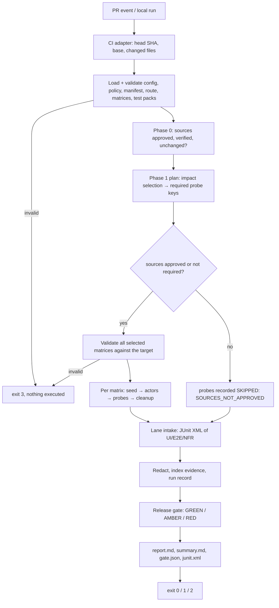

# Architecture

## Flow of one run

## Modules

| Module | Responsibility | Must not |
| --- | --- | --- |
| `cli` | Arguments, signals, exit codes | Contain QA logic |
| `orchestrator` | Stage order, artifacts, re-gate | Know HTTP or auth details |
| `config`, `core/schemas` | Versioned contracts (zod → JSON Schema) | Accept unknown keys |
| `lifecycle` | Phase 0 sources, Phase 1 test packs, change impact | Invent expectations |
| `permission` | Matrix validation, templates, classification, shared driver | Decide release readiness |
| `adapters/http` | Generic REST/GraphQL target from `target.yaml` | Leak credentials outside the class |
| `adapters/fake` | In-memory target for deterministic tests | Be used in production runs |
| `adapters/ci` | PR context, summaries (GitHub Actions, local) | Hold business rules |
| `lanes` | JUnit intake for lanes run by other tools | Trust report content |
| `evidence` | Redaction, sanitized evidence files, checksum index | Store secrets or bodies by default |
| `reporting` | Markdown, JUnit, run record | Recalculate outcomes |
| `release-gate` | Deterministic policy evaluation | Consult an LLM |
| `ai` | Review AI proposals, triage, sanitized model context | Change matrices, results or the gate |

Dependency direction: `cli → orchestrator → {lifecycle, permission, lanes,
evidence, reporting, release-gate}`; adapters implement `core/interfaces.ts`;
`ai` reads run records and approved inputs only.

## Result model

Every lane produces the same `TestResult` (`schemas/test-result.schema.json`),
keyed by `lane:suite:test`. Statuses: `PASS`, `FAIL`, `BLOCKED`,
`INCONCLUSIVE`, `SKIPPED`, `NOT_APPLICABLE`; a `category` explains every
non-PASS (e.g. `PRIVILEGE_ESCALATION`, `TIMEOUT`, `NO_EXPECTATION`).

## Artifacts of a run (`<evidence.directory>/<run-id>/`)

| File | Content |
| --- | --- |
| `run.json` | Immutable run record: plan, sources, route, manual results, lifecycle events, results, evidence index |
| `gate.json` | Decision, verdict, reasons, waivers, counts, policy version |
| `report.md` / `summary.md` | Full report / compact summary for PR comments |
| `junit.xml` | All results for CI test views |
| `evidence/` | One redacted JSON per probe, copied lane reports, `index.json` with sha256 |
| `regate.json` | Written by `gate`; `run.json` is never rewritten |

Decisions are recorded in [adr/](adr/).
